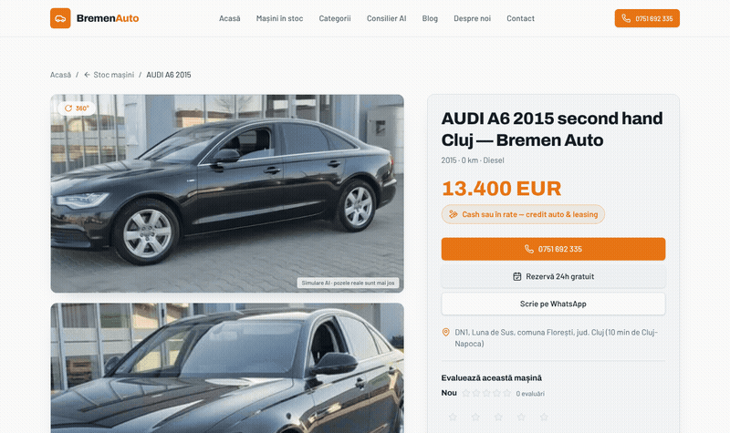

# Bremen Auto

Showroom website for Bremen Auto, a used-car dealership on DN1 in Luna de Sus (Florești, Cluj).

**Live site:** https://bremenauto.ro



## Features

- Stock list and car pages with a drag-to-rotate 360° turntable (sprite-sheet frames, touch and mouse, inertia)
- Landing pages per model, budget and city, blog, sitemaps and IndexNow submissions on every stock change
- Reservation, finance calculator, stock alerts and anonymous car ratings
- Admin area for stock, leads and SEO
- Ad inventory: AdSense behind the Google CMP, plus Adsterra banners, native and social bar

## Stack

TanStack Start (React 19, SSR), TypeScript, Tailwind CSS 4, Supabase (Postgres, auth, RLS), Vite, Cloudflare Workers.

## Getting started

Requires Node.js 22+ and [Bun](https://bun.sh).

```sh
git clone https://github.com/alexalghisi/rrr-auto-showcase.git
cd rrr-auto-showcase
bun install
bun run dev
```

The app reads the Supabase project from `.env`.

## Scripts

| Command | Purpose |
| --- | --- |
| `bun run dev` | Development server |
| `bun run build` | Production build (`.output/`) |
| `bun run preview` | Serve the production build |
| `bun test` | Unit tests |
| `npx tsc --noEmit` | Type check |
